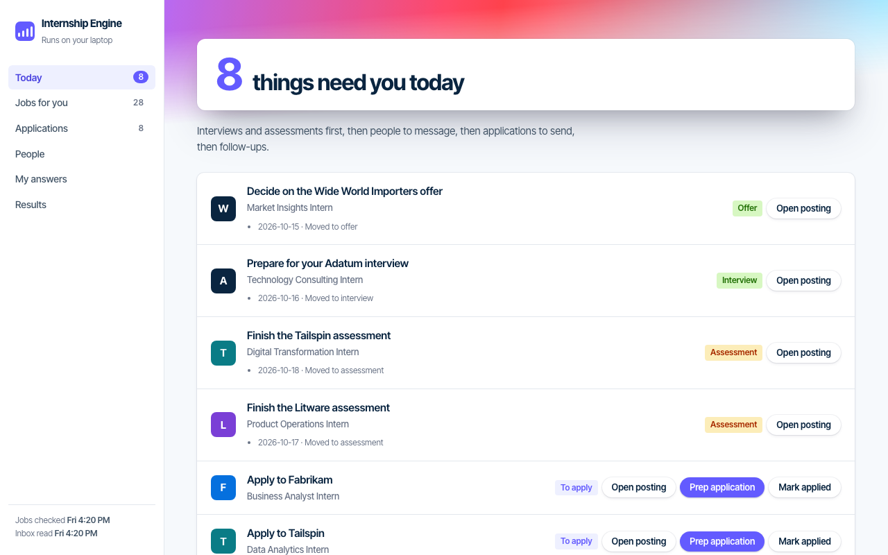
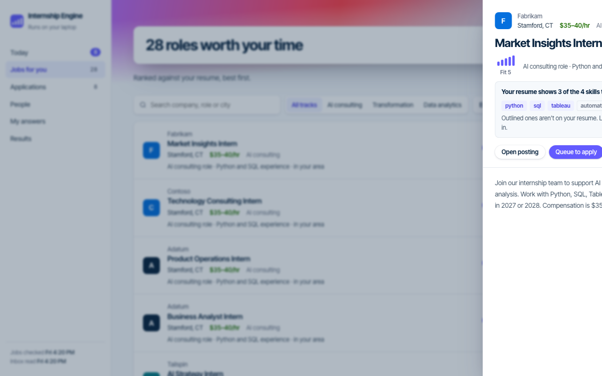
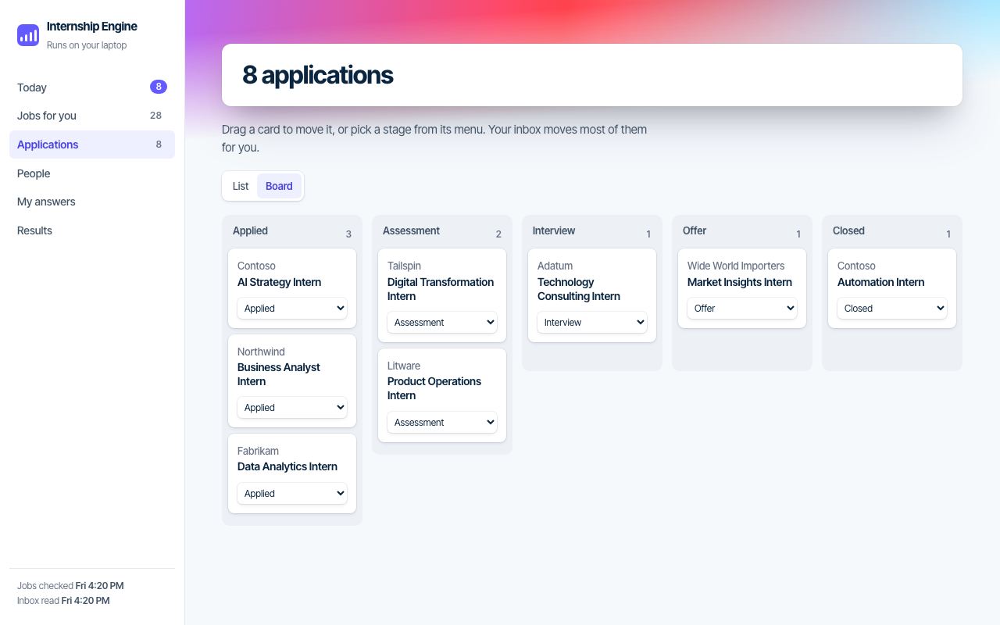
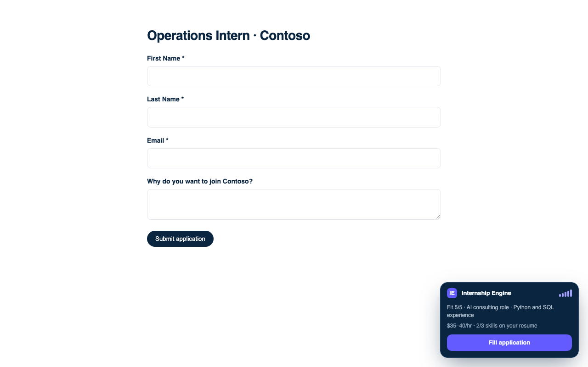

# Chrome Web Store publishing notes

GitHub Releases can distribute the extension ZIP for manual **Load unpacked** installation. Chrome requires extensions intended for ordinary one-click installation to be published through the Chrome Web Store. This repository has no published store listing yet.

## Draft listing

- **Name:** Internship Engine
- **Short description:** Save and prepare internship applications using your local profile. You review and submit every application.
- **Single purpose:** Help a user save internship postings and fill application fields from the user's own local profile.
- **Support URL:** `https://github.com/omar-colab/internship-engine/issues`
- **Privacy policy URL:** `https://omar-colab.github.io/internship-engine/privacy.html`
- **Category:** Productivity

### Data and permissions disclosure

The extension stores an engine token in `chrome.storage.local`. On supported job-board pages, its content script reads the current URL, posting title, and visible application-field labels and options. It sends only the data needed for lookup, saving, and answer generation to the user's local engine at `127.0.0.1:8765`, authenticated with that token. If the user chooses to fill a form that has a resume field, the extension retrieves the resume from the same local engine and assigns it to that page's file field. The extension does not send this data to the project maintainers or a project-operated server. The user reviews and submits each application.

Permission justifications:

- `storage`: retain the user's local engine token between browser sessions.
- `host_permissions` for `127.0.0.1:8765`: connect to the local engine the user runs on their computer.
- Content-script match patterns: read and fill the supported job-board pages only after the user visits them.

### Draft screenshots

Regenerate these with `uv run python scripts/store_screenshots.py` (Playwright Chromium required). The script seeds a scratch tracker
with fictional data and uses the existing fictional Greenhouse form fixture; it never reads `data/`.

## Before submitting

1. Confirm the store developer account is owned by the project maintainer and has two-step verification enabled.
2. Upload the ZIP attached to a GitHub Release. The workflow checks that its version matches `extension/manifest.json` and that `manifest.json` is at the ZIP root.
3. Complete the Store Listing and Privacy tabs using the disclosures above, and add real screenshots of the extension on supported pages.
4. Submit for review. Chrome reviews the listing before it can offer one-click installation; use the official [publishing guide](https://developer.chrome.com/docs/webstore/publish/).
5. After approval, add the Chrome Web Store listing link to the repository README and landing page. Do not label a GitHub ZIP as a one-click Chrome install.

Do not commit Web Store API credentials, refresh tokens, or signing keys to this repository.
